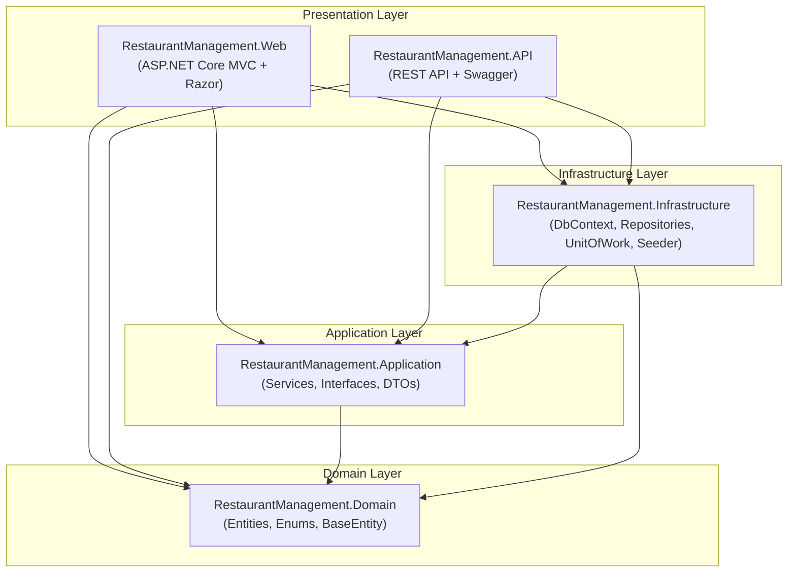
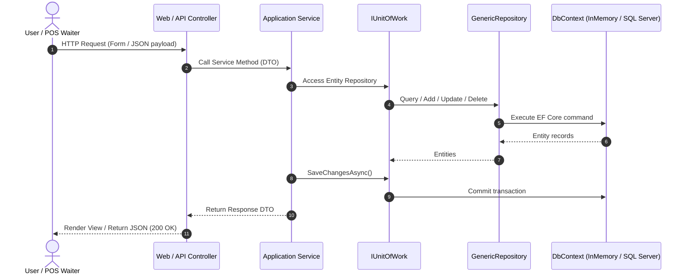

# PROJECT_ARCHITECTURE.md – Architecture & System Design

## 1. Architectural Overview

The **Restaurant Management System (Girana RMS)** is built using a **Clean / Onion Layered Architecture** on **.NET 9.0**. It cleanly separates domain rules, application business logic, infrastructure persistence, and presentation layers (MVC Web and Web API).

---

## 2. Project Responsibilities & Dependencies

### 1. `RestaurantManagement.Domain`
- **Framework**: `net9.0` (Class Library)
- **External Dependencies**: None (Pure C# domain layer).
- **Contents**:
  - `Entities/`: Core domain models (`Order`, `OrderItem`, `Table`, `Floor`, `MenuItem`, `Category`, `Bill`, `Payment`, `Customer`, `LoyaltyAccount`, `InventoryItem`, `Recipe`, `Employee`, `Attendance`, `Expense`, `User`, `RestaurantSetting`).
  - `Enums/`: Domain enumerations (`UserRole`, `OrderStatus`, `OrderType`, `TableStatus`, `PaymentMode`, `PaymentStatus`, `KOTStatus`, `LoyaltyTier`, `ReservationStatus`).
  - `BaseEntity.cs`: Common audit properties (`Id`, `CreatedAt`, `UpdatedAt`, `IsDeleted`).

### 2. `RestaurantManagement.Application`
- **Framework**: `net9.0` (Class Library)
- **Dependencies**: `RestaurantManagement.Domain`, `FluentValidation.DependencyInjectionExtensions`.
- **Contents**:
  - `Interfaces/`: Contracts for business logic (`IAuthService`, `ITableService`, `IMenuService`, `IOrderService`, `IKOTService`, `IBillingService`, `ICustomerService`, `IReservationService`, `IInventoryService`, `IStaffService`, `IDashboardService`, `IReportService`, `IUnitOfWork`).
  - `Services/`: Business implementations corresponding to each interface.
  - `DTOs/`: Strongly-typed Data Transfer Objects for API and Presentation boundaries (`AuthDtos.cs`, `BillingDtos.cs`, `MenuDtos.cs`, `OperationsDtos.cs`, `OrderDtos.cs`, `TableDtos.cs`).

### 3. `RestaurantManagement.Infrastructure`
- **Framework**: `net9.0` (Class Library)
- **Dependencies**: `RestaurantManagement.Application`, `RestaurantManagement.Domain`, `Microsoft.EntityFrameworkCore`, `Microsoft.EntityFrameworkCore.SqlServer`, `Microsoft.EntityFrameworkCore.InMemory`.
- **Contents**:
  - `DbContext/RestaurantDbContext.cs`: EF Core database context configured with model constraints, decimal precisions, and entity relationships.
  - `Repositories/GenericRepository.cs`: Generic CRUD abstraction (`IGenericRepository<T>`).
  - `Repositories/UnitOfWork.cs`: Implementation of `IUnitOfWork` coordinating transactions across all repositories.
  - `Data/DbInitializer.cs`: Seeds complete realistic restaurant data (tables, menus, admin/manager/waiter users, floor layouts, initial inventory).

### 4. `RestaurantManagement.Web`
- **Framework**: `net9.0` (ASP.NET Core Web App / MVC)
- **Dependencies**: `RestaurantManagement.Application`, `RestaurantManagement.Domain`, `RestaurantManagement.Infrastructure`, `Serilog.AspNetCore`.
- **Contents**:
  - `Controllers/`: MVC Controllers (`AccountController`, `DashboardController`, `OrdersController`, `TablesController`, `MenuController`, `BillingController`, `KitchenController`, `InventoryController`, `StaffController`, `MastersController`, `ReportsController`).
  - `Views/`: Razor Views organized per controller with shared layout (`_Layout.cshtml`).
  - `Models/`: ViewModels representing screen data.
  - `wwwroot/`: Static assets (Bootstrap, jQuery, FontAwesome, custom CSS, POS JavaScript modules).
  - Authentication: Cookie Authentication (`GiranaRMS.Auth`) with role-based routing.

### 5. `RestaurantManagement.API`
- **Framework**: `net9.0` (ASP.NET Core Web API)
- **Dependencies**: `RestaurantManagement.Application`, `RestaurantManagement.Domain`, `RestaurantManagement.Infrastructure`, `Microsoft.AspNetCore.Authentication.JwtBearer`, `Swashbuckle.AspNetCore`, `Serilog.AspNetCore`.
- **Contents**:
  - `Controllers/`: Dedicated API controllers (`AuthController`, `OrdersController`, `KOTsController`, `BillsController`, `TablesController`, `FloorsController`, `CategoriesController`, `MenuItemsController`, `CustomersController`, `ReservationsController`, `InventoryController`, `StaffController`, `ReportsController`).
  - Authentication: JWT Bearer Token validation.
  - Documentation: OpenAPI / Swagger UI at `/swagger`.

### 6. `RestaurantManagement.Tests`
- **Framework**: `net9.0` (xUnit Test Project)
- **Dependencies**: `RestaurantManagement.Application`, `RestaurantManagement.Domain`, `RestaurantManagement.Infrastructure`, `xunit`, `Microsoft.NET.Test.Sdk`.
- **Contents**:
  - `OrderServiceTests.cs`: Unit tests for subtotal calculations, tax rules, and item management.
  - `WorkedExampleTable04Tests.cs`: Full lifecycle test for Table 04 (from guest seating to bill settlement).
  - `ScenarioTests.cs`: Scenario matrix testing covering business rule scenarios (OM-A01 to OM-J).

---

## 3. Communication & Data Flow

---

## 4. Key Business Workflows

### 1. Order & POS Lifecycle (Section A / Section B)
- **Drafting**: Waiter opens Table -> Selects covers -> Adds items into **Section B (Draft)**. Table remains `Available`.
- **KOT Transmission**: Waiter taps **Send KOT** -> Table transitions to `Occupied` -> Initial `KOT` generated (`KOT-0001`) -> Items move to **Section A (Sent)**.
- **Addition**: Subsequent additions create `Addition KOT` slips (`KOT-0002`) containing only newly added items.
- **Cancellation**: Reducing/cancelling sent items emits `Cancel KOT` slip with reason.

### 2. Kitchen Operating Modes (Masters → Settings)
- **Mode 1 (Full KDS)**: Kitchen screen interaction (`Preparing` -> `Ready` -> `Served`).
- **Mode 2 (Printer Only)**: Direct printing to thermal printer; bypasses `Preparing`.
- **Mode 3 (No Device / Counter)**: Verbal/paper counter slips; waiter taps `Served` directly.

### 3. Billing & Payment Settlement
- Customer requests bill -> Bill generated (`INV-XXXXX`) -> Table status transitions to `Billing`.
- Payment collection supports **Split Tender** (Cash, UPI, Card, Loyalty Points).
- Upon full payment: Order marked `Completed`, Bill marked `Paid`, Table transitions back to `Available`.

### 4. Loyalty & Customer Progression
- **Silver Tier**: Initial tier.
- **Gold Tier**: Total spend >= ₹20,000.
- **Platinum Tier**: Total spend >= ₹50,000.
- Points earned: 1 point per ₹100 spent on bill payment.
